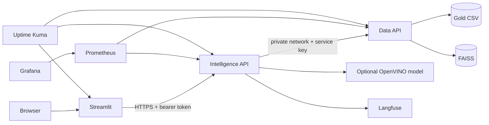

# HorRAGor

HorRAGor is a local-first, multi-agent assistant for horror cinema. It combines
a reconciled movie data pipeline, a private FAISS data API, a LangGraph
intelligence API, a Streamlit chat UI, an optional OpenVINO model service, and a
complete local observability stack.

## Architecture



The LangGraph workflow has no manager agent:

```text
START -> RAG -> conditional router -> Narration -> END
                            |
                            +-> Scraper -> Narration
```

- **RAG** resolves explicit titles and follow-ups, retrieves local evidence, and
  invokes only the five bounded movie tools.
- **Scraper** runs only when local evidence is weak or detailed web evidence is
  requested.
- **Narration** receives clipped evidence without retrieval plumbing and uses a
  gothic local model or an explicit deterministic fallback.

## Quick Start

Requires Python 3.11+ and [uv](https://docs.astral.sh/uv/).

```powershell
uv sync
$env:LANGFUSE_TRACING_ENABLED = "false"
$env:HORRAGOR_DISABLE_LLM = "true"
uv run uvicorn src.API.main_api:app --host 127.0.0.1 --port 8000
```

In another terminal:

```powershell
uv run streamlit run app_frontend.py
```

Open `http://127.0.0.1:8501`. Local development keeps authentication disabled
unless `HORRAGOR_AUTH_ENABLED=true` is set. The API uses the in-process FAISS
adapter unless `HORRAGOR_DATA_API_URL` points to the private data service.

To run the bundled OpenVINO model locally, install its isolated extra and start
the model API before the intelligence API:

```powershell
uv sync --extra model
$env:HORRAGOR_LLM_DEVICE = "AUTO"
uv run uvicorn server.server:app --host 127.0.0.1 --port 8001
```

## Docker Stack

Copy `.env.example` to the ignored `.env` file and replace every placeholder.
Generate secrets without putting passwords in shell history:

```powershell
uv run python -m src.auth.cli generate-secret
uv run python -m src.auth.cli hash-password
```

Keep the generated Argon2 hash single-quoted in `.env`. Validate and start the
complete stack:

```powershell
docker compose config --quiet
docker compose up --build -d
```

Enable the resource-intensive local model explicitly:

```powershell
docker compose --profile local-model up --build -d
```

| Component | Local URL | Exposure |
| --- | --- | --- |
| Streamlit | `http://127.0.0.1:8501` | User-facing, loopback only |
| Langfuse | `http://127.0.0.1:3000` | Admin, loopback only |
| Grafana | `http://127.0.0.1:3001` | Admin, loopback only |
| Uptime Kuma | `http://127.0.0.1:3002` | Admin, loopback only |
| Prometheus | `http://127.0.0.1:9090` | Admin, loopback only |
| Intelligence API | Internal HTTPS | No host port |
| Data API | Internal HTTP + service key | No host port |

Compose generates a private CA and API certificate. Streamlit and Prometheus
mount only the public CA; the private key is mounted only into the intelligence
API. The data API is confined to private networks and is unreachable from the
browser and host. HorRAGor's service key, JWT secret, and password hash are
mounted as Docker secrets rather than container environment values.

## Authentication

Production uses Argon2id credentials, short-lived HS256 access tokens, and
persisted one-time refresh-token rotation. Refresh tokens are stored only as
SHA-256 hashes. Replayed, expired, or revoked refresh tokens are rejected.
Streamlit refreshes once after a `401` and clears its session if rotation fails.
It refuses to send credentials over non-loopback plain HTTP.
POST bodies are capped at 128 KiB before schema parsing by default.

Endpoints:

- `POST /auth/login`
- `POST /auth/refresh`
- `POST /auth/logout`
- `POST /chat` (protected in auth-enabled environments)
- `GET /movies/search` (protected in auth-enabled environments)
- `GET /health`
- `GET /metrics` (private network in Compose)

## Brief 1 Data Pipeline

The optional `ingestion` extra implements all five acquisition channels:

1. TMDB horror discovery API.
2. Dynamic Rotten Tomatoes scraping with Selenium.
3. Local Kaggle CSV processing with Polars.
4. IMDb SQLite `title_basics`/`title_ratings` extraction with Horror/Gore and
   `numVotes >= 1000` gates.
5. Split IMDb processing with PySpark.

All records pass through Unicode/HTML/text normalization, ISO 8601 date
normalization, score validation, strict horror filtering, and priority-aware
reconciliation. Matching uses TMDB ID, IMDb ID, exact title and year, then fuzzy
title and year. The reconciled UTF-8 gold CSV is atomically replaced before the
optional SQLAlchemy/Supabase upsert and FAISS rebuild.

```powershell
uv sync --extra ingestion
$env:TMDB_BEARER_TOKEN = "..."
$env:KAGGLE_CSV_PATHS = "C:\data\movies.csv"
$env:IMDB_SQLITE_PATH = "C:\data\imdb.db"
uv run horragor-ingest --strict
```

Persistence supports `DATABASE_URL` through SQLAlchemy or backend-only
`SUPABASE_URL` plus `SUPABASE_SERVICE_ROLE_KEY`. The PostgreSQL/pgvector schema
and restrictive RLS defaults are in `migrations/001_initial.sql`.

## Five Safe Tools

| Tool | Bound input | Owner |
| --- | --- | --- |
| `query_movie_metadata` | Canonical movie ID | RAG |
| `find_similar_horror_movies` | Canonical ID and bounded `k` | RAG |
| `scrape_detailed_synopsis` | Resolved title | Scraper |
| `calculate_movie_age` | Known four-digit year | RAG |
| `horror_survival_simulator` | Supplied synopsis | RAG |

The model never generates SQL. Metadata and similarity calls are rebound to
resolved local identifiers. Similarity uses synopsis vectors only, never titles.

## Observability

Loguru receives standard Python and Uvicorn logs and emits structured production
JSON with request IDs. Prometheus records request rates, errors, active calls,
latency, graph routes, narration modes, token totals, and tool outcomes. Grafana
provisions the `HorRAGor Overview` dashboard.

For Uptime Kuma, configure these internal monitors:

- `http://data-api:8002/health`
- `https://intelligence-api:8000/health` using `/certs/ca.crt`
- `http://ui:8501/_stcore/health`

Langfuse creates one `answer-chat-question` trace per turn, grouped by Streamlit
session. Its tree contains typed agent, retriever, tool, and generation
observations. Generations include model parameters and reported token usage.
Tracing is optional and disabled with `LANGFUSE_TRACING_ENABLED=false`.

## Quality Gates

```powershell
uv sync --extra docs
uv run ruff check src tests app_frontend.py server
uv run mypy src server app_frontend.py --ignore-missing-imports
$env:LANGFUSE_TRACING_ENABLED = "false"
uv run pytest -q
uv run pytest tests/test_auth.py tests/test_langfuse_integration.py tests/test_main_api.py --cov=src.API --cov-fail-under=80 -q
uv run pytest tests/test_data_api.py --cov=src.data_api --cov-fail-under=80 -q
uv run pytest tests/test_ui_client.py --cov=src.ui --cov=app_frontend --cov-fail-under=80 -q
uv run sphinx-build -E -W --keep-going -b html docs docs/_build/html
docker compose config --quiet
```

Current measured coverage is 96% for the intelligence API, 94% for the data API,
and 89% for Streamlit plus its client. GitHub Actions enforces each threshold
independently, builds documentation, validates Compose, and builds service
containers. Semantic `v*` tags publish four GHCR images with SBOM and provenance.

## Documentation and Governance

The full Sphinx source is in `docs/` and includes automatic API documentation,
service and LangGraph maps, MCD/MLD/MPD, security, deployment, monitoring,
testing, and governance procedures.

Every implementation defect, model behavior deviation, monitoring alert, and
failed quality gate must be archived through the GitHub issue forms. Pull
requests must link the requirement and issue, describe risk and rollback, and
include validation and observability evidence.
